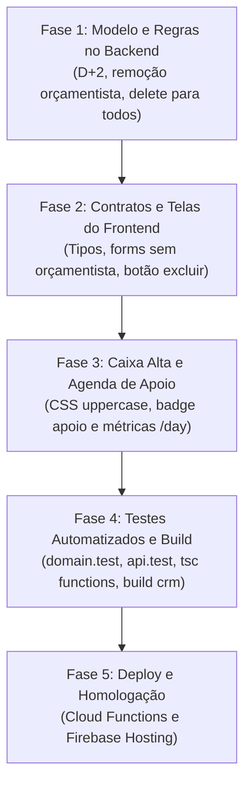

# Plano de Implementação — Ajustes no CRM Desenhar

Este documento detalha o plano de implementação técnica para atender aos 5 requisitos de melhoria e ajustes funcionais no CRM (`crm/` e `functions/src/crm/`).

---

## 1. Resumo dos Requisitos

1. **Follow-up D+1, D+2, D+3 e D+7**: incluir a etapa de acompanhamento **D+2** útil no ciclo automático de follow-ups pós-envio de proposta.
2. **Clientes e Empresas em Caixa Alta (UPPERCASE)**: garantir que nomes de clientes e empresas sejam exibidos e persistidos sempre em maiúsculas em todas as telas, buscas, cadastros e relatórios.
3. **Remoção da Categoria de Orçamentista e Validação Complexa**: remover completamente o perfil `orcamentista`, campos de atribuição de orçamentista (`estimatorId`), status de elaboração de orçamento (`budgetStatus`), bem como a validação de propostas complexas (`complexity`, `approval` e validadores de propostas complexas `ApproverPicker`/`approverIds`) no frontend e backend.
4. **Negociação na Agenda do Apoio Solicitado**: auditar e garantir que, quando um vendedor solicita apoio à negociação, essa oportunidade/tarefa apareça de forma clara na agenda ("Meu Dia") do usuário indicado como apoio, com contadores e dados corretos.
5. **Permissão de Exclusão de Oportunidades para Todas as Roles**: permitir que qualquer perfil ativo do CRM (`admin`, `coordenacao`, `vendedor`, `recepcao`) possa excluir oportunidades.

---

## 2. Detalhamento Técnico e Plano por Item

---

### Item 1: Follow-up D+1, D+2, D+3 e D+7

#### 1.1 Contexto e Diagnóstico Atual
- No backend (`functions/src/crm/domain.ts`), a geração de tarefas na ação `'send'` executa um loop sobre `[1, 3, 7]` dias úteis.
- O tipo `Task['kind']` e `TaskKind` em `crm/src/contracts.ts` está tipado como `'D+1' | 'D+3' | 'D+7' | 'Retomada' | 'Manual' | 'Coordenação'`.
- O cálculo de remarcação (`correctSentDate`) utiliza `Number(t.kind.slice(2))`, o que já é compatível dinamicamente com `'D+2'`.
- A mensagem explicativa no frontend (`crm/src/OpportunityDetail.tsx:403`) indica `"Serão criadas tarefas em D+1, D+3 e D+7 úteis."`.

#### 1.2 Alterações Necessárias
- **`functions/src/crm/domain.ts`**:
  - Atualizar `Task['kind']`: adicionar `'D+2'`.
  - No bloco `case 'send'`:
    ```ts
    for (const n of [1, 2, 3, 7])
        tasks.push(makeTask(o, `D+${n}` as Task['kind'], businessDays(sent, n, settings.holidays), now, `d${n}`, n === 7));
    ```
    *(Nota: `n === 7` continua sendo a marcação de `finalFollowUp: true`).*
- **`crm/src/contracts.ts`**:
  - Atualizar `TaskKind`:
    ```ts
    kind: 'D+1' | 'D+2' | 'D+3' | 'D+7' | 'Retomada' | 'Manual' | 'Coordenação';
    ```
- **`crm/src/OpportunityDetail.tsx`**:
  - Atualizar linha 403:
    `"Serão criadas tarefas em D+1, D+2, D+3 e D+7 úteis."`
- **`functions/src/crm/domain.test.ts` e `api.test.ts`**:
  - Atualizar os testes unitários de geração automática para esperar 4 tarefas (`d1`, `d2`, `d3`, `d7`).

---

### Item 2: Clientes e Empresas em Caixa Alta (UPPERCASE)

#### 2.1 Contexto e Diagnóstico Atual
- Nomes de clientes (`Client.name`) e empresas (`Company.name`) podem ter sido cadastrados em minúsculas ou capitalizados em momentos anteriores.
- É necessário garantir duplo nível de consistência:
  1. **Visual imediato**: mesmo registros antigos no Firestore devem ser exibidos em caixa alta no frontend.
  2. **Persistência sanitizada**: novos registros ou edições devem salvar os valores transformados em `.trim().toUpperCase()`.

#### 2.2 Alterações Necessárias
- **Backend (`functions/src/crm/api.ts`)**:
  - Em `POST /clients` e `PUT /clients/:id`:
    ```ts
    const name = text(req.body.name, 'Nome', 150, true).toUpperCase();
    ```
  - Em `POST /companies` e `PUT /companies/:id`:
    ```ts
    const name = text(req.body.name, 'Razão/Nome', 150, true).toUpperCase();
    ```
- **Frontend (`crm/src/styles/crm.css` e componentes)**:
  - Adicionar regra de CSS para que campos e tags com nomes de cliente/empresa sempre renderizem em maiúsculas:
    ```css
    .client-name,
    .company-name,
    .record-title,
    .crm-select-uppercase option,
    td.col-client,
    td.col-company {
      text-transform: uppercase;
    }
    ```
  - No `crm/src/components/Combobox.tsx`, `CompanySelect.tsx` e `NewOpportunity.tsx`: exibir as opções com `.toUpperCase()`.
  - No `crm/src/Workspace.tsx`, `Catalogs.tsx`, `OpportunityDetail.tsx` e `ReportsPage.tsx`:
    Garantir a exibição de `(client?.name || '').toUpperCase()` e `(company?.name || '').toUpperCase()`.

---

### Item 3: Tirar Categoria de Orçamentista e Validação de Proposta Complexa

#### 3.1 Contexto e Diagnóstico Atual
- O perfil `'orcamentista'` foi descontinuado do fluxo de vendas do CRM.
- Como não há mais orçamentista, a validação de propostas complexas e a seleção de validadores tornaram-se obsoletas.
- No backend:
  - `Role` incluía `'orcamentista'`.
  - `Opportunity` continha `estimatorId`, `budgetStatus`, `complexity` e `approval`.
  - `applyCommand` continha `command === 'approve'` e `approvalOnly`.
  - `/settings` continha validação e lista de `approverIds`.
- No frontend:
  - `Settings.tsx` exibia o campo "Validadores de propostas complexas" (`ApproverPicker`).
  - `OpportunityDetail.tsx` exibia o campo "Complexidade", notas de validação e bloco "Registrar validação".

#### 3.2 Alterações Realizadas
- **Backend (`functions/src/crm/domain.ts` e `api.ts`)**:
  - Removido `'orcamentista'` de `Role`.
  - Removido `command === 'approve'` de `applyCommand`.
  - Removida verificação e gerenciamento de `approverIds` em `PUT /settings`.
  - Removidos campos de complexidade e aprovação de `newOpportunity` e `patchOpportunity`.
- **Frontend (`crm/src/Settings.tsx` e `OpportunityDetail.tsx`)**:
  - Removido o campo "Validadores de propostas complexas" e excluído o componente `ApproverPicker.tsx`.
  - Removido o seletor "Complexidade", o bloco visual "Validação" e a ação "Registrar validação" do modal de detalhes.
- **Documentação (`docs/GUIA-USO-CRM.md`)**:
  - Removidas todas as menções a validadores de propostas complexas.

---

### Item 4: Negociação na Agenda do Apoio Solicitado

#### 4.1 Contexto e Diagnóstico Atual
- Quando o vendedor está na aba **Negociação** de uma oportunidade e registra objeção solicitando apoio (`action: 'objection'`):
  - É criada uma tarefa de `kind: 'Coordenação'` com `t.ownerId = coordinatorId` e `dueDate = raw.dueDate`.
- **Problemas identificados**:
  1. No backend (`functions/src/crm/api.ts:284-285`), o endpoint `/day` filtrava fora as tarefas de coordenação dos contadores:
     ```ts
     const todayTasks = tasks.filter(t => t.kind !== 'Coordenação' && t.status !== 'cancelled' && t.dueDate === day);
     const planned = tasks.filter(t => t.kind !== 'Coordenação' && ...);
     ```
     Isso fazia com que o apoio solicitado **não aumentasse o contador** de tarefas do dia do usuário que recebeu a solicitação.
  2. No frontend (`crm/src/OpportunityDetail.tsx:587-593`), o campo "Solicitar apoio" filtrava apenas usuários com perfil `['admin', 'coordenacao']`.
  3. Na listagem de "Meu Dia" (`crm/src/Workspace.tsx`), a tarefa aparecia discretamente com `<small>Coordenação</small>`, sem destaque visual de que se trata de uma solicitação de auxílio na negociação, sem indicar quem é o vendedor requerente nem o teor da objeção.

#### 4.2 Alterações Necessárias
- **Backend (`functions/src/crm/api.ts`)**:
  - Ajustar o cálculo de `todayTasks` e `planned` para incluir tarefas de apoio/coordenação:
    ```ts
    const todayTasks = tasks.filter(t => t.status !== 'cancelled' && t.dueDate === day);
    const planned = tasks.filter(t => (t.status === 'pending' && t.dueDate <= day) || (t.status === 'done' && t.completedDate === day));
    ```
  - Garantir que as tarefas de `t.kind === 'Coordenação'` tragam o objeto `opportunity`, `client` e `company` anexados (já atendido via `allOpps`).
- **Frontend (`crm/src/OpportunityDetail.tsx`)**:
  - Permitir que qualquer vendedor ou coordenador possa ser selecionado como apoio quando necessário (ou manter coordenação/admin + vendedores ativos da equipe).
- **Frontend (`crm/src/Workspace.tsx`)**:
  - No grid/tabela de acompanhamentos de "Meu Dia", adicionar uma tag/badge de destaque para tarefas de Apoio (`t.kind === 'Coordenação'`), exibindo por exemplo:
    - Badge: `Apoio Negociação` com estilo visual diferenciado.
    - Na coluna de detalhes: exibir o nome do vendedor titular da oportunidade e o texto da objeção (`t.notes` ou `t.opportunity.objection`).
  - No filtro de abas ("Hoje", "Atrasadas", "Próximas"), garantir que essas tarefas permaneçam ordenadas por urgência e que a contagem do badge da aba reflita a pendência.

---

### Item 5: Todas as Roles Devem Poder Excluir Oportunidades

#### 5.1 Contexto e Diagnóstico Atual
- Atualmente, a exclusão de uma oportunidade está bloqueada tanto no backend quanto no frontend:
  - Backend (`functions/src/crm/api.ts:221`): `adminAccess(req.actor);` bloqueia com `403 Sem permissão.` para qualquer usuário que não seja `admin`.
  - Frontend (`crm/src/OpportunityDetail.tsx:104`):
    `{boot.actor.role === 'admin' && <button type="button" className="danger-button" onClick={() => void deleteOpportunity()}>Excluir oportunidade</button>}`
- O requisito define explicitamente: **TODAS AS ROLES DEVEM PODER EXCLUIR OPORTUNIDADES**.

#### 5.2 Alterações Necessárias
- **Backend (`functions/src/crm/api.ts`)**:
  - No endpoint `app.delete('/opportunities/:id', route(async (req, res) => { ... }))`:
    - Substituir `adminAccess(req.actor);` por verificação de permissão geral do CRM:
      ```ts
      ensure(['admin', 'coordenacao', 'vendedor', 'recepcao'].includes(req.actor.role), 'Sem permissão para excluir oportunidades.', 403);
      ```
    - A rotina de exclusão em cascata (remoção do documento da oportunidade, de todas as suas tarefas em `COLLECTIONS.tasks` e do subdocumento de histórico) continua sendo executada em lote com segurança.
- **Frontend (`crm/src/OpportunityDetail.tsx`)**:
  - Liberar o botão de exclusão para todas as roles ativas:
    ```tsx
    {['admin', 'coordenacao', 'vendedor', 'recepcao'].includes(boot.actor.role) && (
      <button
        type="button"
        className="danger-button"
        onClick={() => void deleteOpportunity()}
      >
        Excluir oportunidade
      </button>
    )}
    ```
  - Manter o modal/diálogo de confirmação para prevenir exclusões acidentais:
    `"Excluir esta oportunidade e todo o seu histórico permanentemente?"`
- **Testes (`functions/src/crm/api.test.ts`)**:
  - Atualizar teste de exclusão garantindo que usuários com role `'vendedor'` ou `'recepcao'` conseguem excluir a oportunidade e recebem status `200`.

---

## 3. Matriz de Arquivos Modificados

| Arquivo | Itens Relacionados | Resumo das Alterações |
| :--- | :--- | :--- |
| `functions/src/crm/domain.ts` | 1, 3 | Adiciona `D+2` em `Task['kind']` e loop de `send`. Remove role `orcamentista`, campos `estimatorId` e `budgetStatus`. |
| `functions/src/crm/api.ts` | 2, 3, 4, 5 | Normaliza `name.toUpperCase()` em clientes/empresas. Remove referências a orçamentista em `/access` e validações. Inclui tarefas de apoio nos contadores do `/day`. Libera `DELETE /opportunities/:id` para todas as roles. |
| `crm/src/contracts.ts` | 1, 3 | Atualiza `TaskKind` com `D+2`. Remove `orcamentista` de `Role`, e campos de orçamento de `Opportunity`. |
| `crm/src/api.ts` | 3 | Remove chave `orcamentista` de `roleLabels`. |
| `crm/src/Settings.tsx` | 3 | Remove `'orcamentista'` da lista de perfis atribuíveis. |
| `crm/src/OpportunityDetail.tsx` | 1, 2, 3, 4, 5 | Atualiza texto de D+1..D+7. Remove campos de orçamentista. Libera botão de excluir para todas as roles. Exibe nomes em caixa alta. |
| `crm/src/Workspace.tsx` | 2, 4 | Destaque visual e notas para tarefas de apoio na agenda. Exibição de clientes e empresas em caixa alta. |
| `crm/src/styles/crm.css` | 2, 4 | Regras de `text-transform: uppercase` para nomes de clientes/empresas e estilização do badge de apoio. |
| `functions/src/crm/domain.test.ts` | 1, 3 | Teste de 4 follow-ups (`D+1, D+2, D+3, D+7`). Remoção de testes de orçamentista. |
| `functions/src/crm/api.test.ts` | 1, 3, 4, 5 | Testes de exclusão por vendedor/recepção, métricas do `/day` com apoio, e remoção de orçamentista. |

---

## 4. Plano de Execução Passo a Passo



### Fase 1: Backend (`functions/src/crm/`)
- [x] No arquivo `domain.ts`:
  - Incluir `'D+2'` no tipo `Task['kind']`.
  - Incluir `2` no array de envio: `[1, 2, 3, 7]`.
  - Remover `'orcamentista'` de `Role`, remover `estimatorId` e `budgetStatus`.
- [x] No arquivo `api.ts`:
  - Normalizar nomes de empresas e clientes com `.toUpperCase()`.
  - No `DELETE /opportunities/:id`, liberar para todas as roles ativas (`admin`, `coordenacao`, `vendedor`, `recepcao`).
  - No `/day`, incluir tarefas de coordenação/apoio no `todayTasks` e `planned`.

### Fase 2: Frontend (`crm/src/`)
- [x] No arquivo `contracts.ts` e `api.ts`:
  - Atualizar `TaskKind` e `Role` (removido `orcamentista`).
- [x] No arquivo `OpportunityDetail.tsx`:
  - Remover campos de orçamentista e bloco exclusivo.
  - Liberar botão "Excluir oportunidade" para todas as roles ativas.
  - Atualizar texto de follow-up para citar D+1, D+2, D+3 e D+7.
  - Ampliar seleção de apoio de negociação para coordenadores, administradores e vendedores da equipe.
- [x] No arquivo `Settings.tsx`:
  - Remover perfil orçamentista da lista de seleção de perfis gerenciáveis.

### Fase 3: Visual e Usabilidade (Caixa Alta e Apoio)
- [x] Aplicar regras de CSS (`crm.css`) e renderizadores com `.toUpperCase()` para clientes e empresas em tabelas, cards do Kanban, autocomplete/combobox e cabeçalhos.
- [x] No `Workspace.tsx`, criar destaque visual para tarefas de apoio de negociação na agenda com badge "Apoio à Negociação" e notas de objeção do vendedor.

### Fase 4: Testes e Validação
- [x] Rodar `npm test` em `functions` para validar `domain.test.ts` e `api.test.ts` (74/74 testes passando).
- [x] Rodar `npm run build` em `functions` (`tsc` finalizado com sucesso).
- [x] Rodar `npm run build` em `crm` (`tsc --noEmit && vite build` gerando bundle de produção sem erros).

### Fase 5: Entrega e Deploy
- [ ] Deploy das Cloud Functions (`crmApi`).
- [ ] Deploy do frontend (`crm-desenhar.web.app`).
- [ ] Validação funcional pelo usuário no ambiente de produção.

---

## 5. Critérios de Aceite

1. **Follow-ups**: Ao registrar envio de proposta, exatamente 4 tarefas automáticas são geradas (D+1, D+2, D+3 e D+7 úteis). A tarefa D+7 permanece marcada como `finalFollowUp`.
2. **Caixa Alta**: Todo e qualquer nome de cliente e de empresa aparece em LETRAS MAIÚSCULAS no Kanban, tabela de agenda, catálogo de clientes/empresas, detalhes e selects.
3. **Orçamentista**: O termo e perfil "Orçamentista" não aparece em nenhuma tela de configuração, formulário de oportunidade ou filtro. Registros anteriores continuam funcionando sem quebra.
4. **Agenda de Apoio**: Ao solicitar apoio em uma negociação informando um usuário e data, a tarefa aparece na agenda "Meu Dia" desse usuário na data solicitada, é contabilizada nas métricas diárias e traz a identificação do vendedor e da objeção.
5. **Exclusão para Todas as Roles**: Usuários com perfil `vendedor`, `recepcao`, `coordenacao` e `admin` conseguem clicar em "Excluir oportunidade" e a oportunidade é removida com sucesso junto com seu histórico e tarefas.

