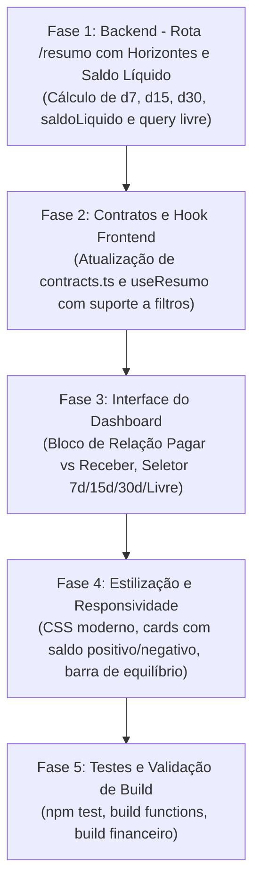

# Plano de Implementação — Atualizações do Dashboard Financeiro

Este documento define o plano técnico e funcional para as melhorias solicitadas no módulo financeiro (`financeiro/` e `functions/src/financeiro/`):

1. **Relação entre Contas a Pagar e Contas a Receber** (Balanço Operacional, Saldo Líquido e Índice de Cobertura).
2. **Controle de Projeção de Dias** (Horizontes rápidos de 7 dias, 15 dias, 30 dias ou período Livre com datas customizadas).

---

## 1. Escopo Funcional

### 1.1 Relação Contas a Pagar vs Contas a Receber
Atualmente, o dashboard exibe os números de Contas a Receber e Contas a Pagar em blocos isolados, sem cruzar as informações.
A nova versão apresentará:
- **Saldo Líquido da Projeção**: `Total a Receber no período − Total a Pagar no período`.
  - Se positivo: superávit operacional previsto (destaque positivo/verde).
  - Se negativo: déficit operacional / necessidade de caixa prevista (destaque negativo/vermelho).
- **Saldo Líquido Total em Aberto**: saldo consolidado de toda a carteira pendente (`Receber em aberto − Pagar em aberto`).
- **Saldo Líquido Vencido**: situação líquida de atrasos (`Receber vencido − Pagar vencido`).
- **Índice de Cobertura Financeira**: percentual indicativo de quanto dos pagamentos estão cobertos pelos recebimentos esperados (`(Receber / Pagar) * 100`).
- **Barra Visual de Equilíbrio**: representação gráfica da divisão proporcional entre Contas a Receber e Contas a Pagar no período.

### 1.2 Controle de Projeção de Dias
Permitir que o gestor financeiro projete o fluxo nos seguintes horizontes:
- **7 Dias** (curtíssimo prazo / semana corrente)
- **15 Dias** (quinzena operacional)
- **30 Dias** (mês corrente / 30 dias corridos)
- **Período Livre** (seleção personalizada de data inicial e data final)

Ao alternar a projeção:
- Os valores "A Receber no Período" e "A Pagar no Período" são atualizados dinamicamente.
- O bloco de **Relação e Balanço Líquido** recalcula o saldo previsto para o intervalo selecionado.
- Os badges informativos no topo mostram com clareza o intervalo de datas considerado (`Data base`, `Até`).

---

## 2. Arquitetura e Estrutura de Dados

### 2.1 Modelo de Dados (`ResumoFinanceiro`)

```ts
export interface ProjecaoItem {
  receber: number;
  pagar: number;
  saldoLiquido: number;
  indiceCobertura: number | null; // null se pagar == 0
  dataFim: string;
}

export interface ResumoFinanceiro {
  periodo: {
    dataBase: string;
    vencidosAte: string;
    diasProjecao: number | 'livre';
    dataFimProjecao: string;
    dataInicioProjecao?: string;
  };
  receber: {
    emAberto: number;
    vencido: number;
    projetado: number; // no horizonte selecionado
    totalRegistros: number;
  };
  pagar: {
    emAberto: number;
    vencido: number;
    projetado: number; // no horizonte selecionado
    totalRegistros: number;
  };
  saldoLiquido: {
    totalEmAberto: number;  // receber.emAberto - pagar.emAberto
    vencido: number;        // receber.vencido - pagar.vencido
    projetado: number;      // receber.projetado - pagar.projetado
    indiceCoberturaProjetada: number | null;
  };
  horizontes: {
    d7: ProjecaoItem;
    d15: ProjecaoItem;
    d30: ProjecaoItem;
  };
  totalGeral: number;
  syncedAt: string | null;
  syncStatus: 'ok' | 'error' | 'running';
}
```

> **Estratégia de Performance**:
> O endpoint `/financeiro/resumo` já retornará no payload principal os horizontes fixos pré-calculados (`d7`, `d15`, `d30`).
> Com isso, a alternância entre 7, 15 e 30 dias no frontend ocorre com **tempo de resposta instantâneo (0ms de latência)**, sem necessidade de novas requisições.
> Caso o usuário escolha **Livre**, o frontend consulta `/financeiro/resumo?de=YYYY-MM-DD&ate=YYYY-MM-DD` para obter o cálculo exato do período customizado.

---

## 3. Matriz de Arquivos Modificados

| Arquivo | Camada | Responsabilidade |
| :--- | :--- | :--- |
| `functions/src/financeiro/financeiroDomain.ts` | Backend (Contratos) | Adicionar tipagens `ProjecaoItem`, expandir `ResumoFinanceiro` com `saldoLiquido` e `horizontes`. |
| `functions/src/financeiro/routes/lancamentos.ts` | Backend (API) | Implementar cálculo de múltiplos horizontes (7d, 15d, 30d) e query parameters para período livre (`de`, `ate`, `dias`). |
| `financeiro/src/contracts.ts` | Frontend (Contratos) | Sincronizar tipos com o backend. |
| `financeiro/src/hooks/useResumo.ts` | Frontend (Hook) | Suportar passagem de parâmetros de projeção customizada e refetch sob demanda. |
| `financeiro/src/pages/DashboardPage.tsx` | Frontend (Página) | Adicionar seletor de projeção (pills 7d, 15d, 30d, Livre), bloco de Relação Pagar vs Receber, barra de cobertura e cartões atualizados. |
| `financeiro/src/styles/financeiro.css` | Frontend (Estilos) | Estilizar pills de projeção, barra de progresso/cobertura, cards de saldo líquido positivo/negativo e inputs de data livre. |

---

## 4. Plano de Implementação em Fases



---

### Fase 1: Backend (`functions/src/financeiro/`)
- Atualizar `financeiroDomain.ts`:
  - Definir `ProjecaoItem` e atualizar `ResumoFinanceiro`.
- Atualizar `routes/lancamentos.ts`:
  - Ler query params `de`, `ate`, `dias`.
  - Calcular as métricas para a data base atual (horário de São Paulo).
  - Calcular os 3 horizontes:
    - 7 dias corridos a partir de hoje;
    - 15 dias corridos a partir de hoje;
    - 30 dias corridos a partir de hoje.
  - Se houver datas livres (`de` e `ate`), calcular a projeção personalizada correspondente.
  - Calcular `saldoLiquido`:
    - `totalEmAberto = receber.emAberto - pagar.emAberto`
    - `vencido = receber.vencido - pagar.vencido`
    - `projetado = receber.projetado - pagar.projetado`
    - `indiceCobertura = pagar.projetado > 0 ? (receber.projetado / pagar.projetado) * 100 : null`

---

### Fase 2: Frontend Contratos & Hooks (`financeiro/src/`)
- Atualizar `contracts.ts`:
  - Importar as novas interfaces de `ResumoFinanceiro`.
- Atualizar `useResumo.ts`:
  - Permitir chamada com parâmetros opcionais: `useResumo({ de?: string; ate?: string; dias?: number })`.
  - Incluir função para alternar parâmetros e recarregar os dados.

---

### Fase 3: Dashboard (`financeiro/src/pages/DashboardPage.tsx`)
- **Seletor de Projeção no Topo**:
  - Botões estilo *segmented control* / *pills*:
    `[ 7 Dias ] [ 15 Dias ] [ 30 Dias ] [ Personalizado / Livre ]`
  - Quando selecionado "Personalizado / Livre":
    - Exibe formulário inline com `<input type="date">` para data de início e término com botão "Aplicar".
- **Bloco de Relação Contas a Pagar vs Contas a Receber**:
  - **Card de Saldo Projetado**:
    - Destaque em tamanho grande com o valor líquido no período.
    - Se `>= 0`: cor verde esmeralda com indicador de superávit previsto.
    - Se `< 0`: cor âmbar/vermelha com indicador de necessidade de caixa.
  - **Card de Saldo Líquido Geral**:
    - Saldo líquido total considerando todas as contas em aberto.
  - **Card de Cobertura Operacional**:
    - "Para cada R$ 1,00 a pagar no período, há R$ X,XX a receber".
    - Indicador de índice de cobertura percentual.
  - **Barra de Equilíbrio Receber x Pagar**:
    - Barra horizontal dividida proporcionalmente (verde para receber, bordô/vermelho para pagar).
- **Grids de Recebimentos e Pagamentos**:
  - O card "A Vencer" passa a se chamar "Projeção ({horizonte})" e reflete exatamente o valor do intervalo selecionado.

---

### Fase 4: Estilização (`financeiro/src/styles/financeiro.css`)
- Estilizar o seletor de projeção interativo (efeito hover, active, transições suaves).
- Estilizar o bloco de balanço operacional com design limpo, moderno e profissional, condizente com a identidade visual da Desenhar.
- Manter total responsividade para telas menores (desktop e mobile).

---

### Fase 5: Validação e Testes
- Validar consistência matemática dos saldos:
  - `saldoLiquido === receber.projetado - pagar.projetado`.
- Validar troca instantânea entre 7d, 15d e 30d (sem recarregamento desnecessário).
- Validar busca por período livre (datas customizadas).
- Executar build do backend (`tsc` em `functions`).
- Executar build do frontend (`vite build` em `financeiro`).

---

## 5. Critérios de Aceite

1. O Dashboard exibe um bloco de destaque com o **Saldo Líquido Operacional** e a **Relação entre Contas a Pagar e Contas a Receber**.
2. O usuário pode alternar facilmente entre projeções de **7 dias**, **15 dias**, **30 dias** e **Período Livre**.
3. No modo de período livre, o usuário informa as datas e visualiza os valores correspondentes de contas a pagar, contas a receber e saldo líquido daquele intervalo.
4. Os dados continuam sincronizados com a base TagPlus e refletem com precisão os vencimentos cadastrados.
5. Os builds do frontend e backend passam sem nenhum erro de TypeScript.

