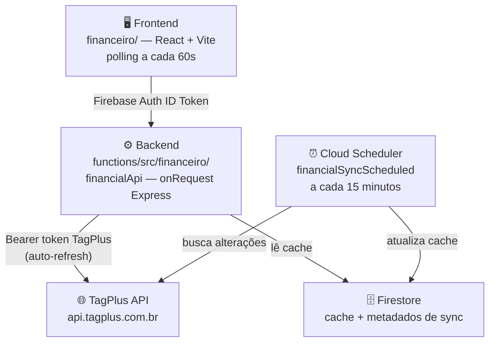

# Plano: Módulo Financeiro — Contas a Pagar/Receber (TagPlus)

> [!IMPORTANT]
> **100% viável sem configuração extra de OAuth.** A integração com TagPlus já está pronta no projeto — `ensureTagPlusAccessToken()` com auto-refresh, `TagPlusClient` e `authMiddleware` são reaproveitados diretamente.

---

## O que já existe no projeto (reutilizado)

| Recurso | Arquivo | O que faz |
|---------|---------|-----------|
| Auto-refresh OAuth | `functions/src/tagplus/tagplusShared.ts` | Renova o token TagPlus automaticamente antes de cada chamada |
| HTTP client TagPlus | `functions/src/tagplus/TagPlusClient.ts` | Axios com Bearer token configurado |
| Auth middleware | `functions/src/utils/authMiddleware.ts` | Protege rotas com Firebase Auth (emails @desenhardigital.com.br) |
| Padrão Express/onRequest | `functions/src/crm/funcCrm.ts` | Mesmo padrão a seguir |
| Design system CSS | `crm/src/styles/crm.css` | DM Sans + Manrope, sem dependências externas |
| Função `api<T>()` | `crm/src/api.ts` | Chama Cloud Functions com Firebase Auth ID token |
| Variáveis de ambiente | Já configuradas | `TAGPLUS_CLIENT_ID`, `CLIENT_SECRET`, `ACCESS_TOKEN`, `REFRESH_TOKEN` ✅ |

---

## Arquitetura proposta



### Estratégia de dados em tempo real

| Mecanismo | Frequência | Descrição |
|-----------|-----------|-----------|
| **Cloud Scheduler** | A cada 15 min | Busca lançamentos alterados na TagPlus e salva no Firestore |
| **Polling no frontend** | A cada 60s | Frontend re-consulta o backend (serve do cache Firestore — rápido) |
| **Sync manual** | Sob demanda | Botão "🔄 Atualizar agora" → `POST /financeiro/sync` |

> [!NOTE]
> Não usamos webhooks porque exigiriam URL pública fixa e configuração manual no painel TagPlus. O polling + scheduler é mais robusto e já funciona com a infra existente.

---

## Estrutura de arquivos

### Backend

```
functions/src/financeiro/
├── funcFinanceiro.ts          ← onRequest (financialApi) + onSchedule (sync)
├── FinanceiroClient.ts        ← Estende TagPlusClient com métodos financeiros
├── financeiroDomain.ts        ← Tipos TypeScript
├── financeiroSync.ts          ← Lógica de sync com Firestore
└── routes/
    ├── lancamentos.ts         ← CRUD de lançamentos
    ├── auxiliares.ts          ← Contas, formas de pagamento, planos orçamentários
    └── sync.ts                ← Trigger manual de sincronização
```

Adicionar em `functions/src/index.ts`:
```typescript
export * from "./financeiro/funcFinanceiro";
```

### Frontend (novo app no monorepo)

```
financeiro/
├── package.json               ← React + Vite (mesmo padrão do /crm)
├── vite.config.ts
├── index.html
└── src/
    ├── api.ts                 ← api<T>() apontando para financialApi
    ├── contracts.ts           ← Tipos do módulo financeiro
    ├── App.tsx
    ├── styles/
    │   └── financeiro.css     ← Derivado do crm.css
    ├── components/
    │   ├── layout/FinanceiroShell.tsx
    │   ├── auth/LoginScreen.tsx
    │   ├── filtros/FiltrosLancamentos.tsx
    │   └── lancamentos/
    │       ├── TabelaLancamentos.tsx
    │       ├── DetalheLancamento.tsx
    │       └── FormBaixa.tsx
    ├── hooks/
    │   ├── useFinanceiroSession.ts
    │   └── useLancamentos.ts     ← polling + filtros + estado
    └── pages/
        ├── DashboardPage.tsx     ← resumo: abertos, vencidos, a vencer
        ├── ContasReceberPage.tsx
        └── ContasPagarPage.tsx
```

---

## Tipos TypeScript principais (`contracts.ts` / `financeiroDomain.ts`)

```typescript
export type TipoLancamento  = 'C' | 'D';  // C=Receber, D=Pagar
export type StatusLancamento = 'aberto' | 'liquidado' | 'vencido' | 'cancelado';

export interface LancamentoFinanceiro {
  id: number;
  descricao: string;
  valor: number;
  valor_pago: number;
  data_emissao: string | null;
  data_vencimento: string;
  data_pagamento: string | null;
  tipo: TipoLancamento;
  status: StatusLancamento;
  entidade_id: number | null;
  entidade_nome: string | null;
  forma_pagamento_id: number | null;
  forma_pagamento_nome: string | null;
  conta_bancaria_id: number | null;
  plano_orcamentario_id: number | null;
  observacoes: string | null;
  _synced_at?: string;  // campo de cache interno
}

export interface FiltrosLancamento {
  tipo?: TipoLancamento;
  status?: StatusLancamento;
  data_vencimento_inicial?: string;
  data_vencimento_final?: string;
  data_pagamento_inicial?: string;
  data_pagamento_final?: string;
  entidade_id?: number;
  q?: string;        // busca por texto na descrição
  page?: number;
  limit?: number;
}

export interface PagedLancamentos {
  items: LancamentoFinanceiro[];
  total: number;
  page: number;
  totalPages: number;
  syncedAt: string | null;
}

export interface AuxiliaresFinanceiro {
  contas: { id: number; nome: string; banco?: string }[];
  formasPagamento: { id: number; nome: string }[];
  planosOrcamentarios: { id: number; nome: string }[];
}

export interface BaixaPayload {
  valor_pago: number;
  data_pagamento: string;
  forma_pagamento_id: number;
  conta_bancaria_id?: number;
}

export interface SyncMeta {
  lastSyncAt: string | null;
  totalSynced: number;
  nextSyncAt: string | null;
  status: 'ok' | 'error' | 'running';
}
```

---

## Endpoints do backend

| Verbo | Rota | Fonte | Descrição |
|-------|------|-------|-----------|
| `GET` | `/financeiro/lancamentos` | Firestore cache | Lista com filtros e paginação |
| `GET` | `/financeiro/lancamentos/:id` | TagPlus direto | Dado sempre fresco |
| `POST` | `/financeiro/lancamentos` | TagPlus + invalida cache | Cria novo lançamento |
| `PUT` | `/financeiro/lancamentos/:id` | TagPlus + atualiza cache | Edita / dá baixa |
| `GET` | `/financeiro/auxiliares` | Firestore (cache 24h) | Contas, formas, planos |
| `POST` | `/financeiro/sync` | TagPlus → Firestore | Sync manual (admin) |
| `GET` | `/financeiro/sync/status` | Firestore | Metadados da última sync |

---

## Lógica de sincronização

```typescript
// financeiroSync.ts — conceitual
async function syncFinanceiro() {
  const tokens = await ensureTagPlusAccessToken();
  const client  = new FinanceiroClient({ accessToken: tokens.access_token });

  // Janela: 90 dias atrás → 60 dias à frente
  const inicio = subDays(new Date(), 90);
  const fim    = addDays(new Date(), 60);

  let page = 1;
  do {
    const result = await client.buscarFinanceiros({
      data_vencimento_inicial: format(inicio),
      data_vencimento_final:   format(fim),
      page, limit: 100,
    });

    // Batch write no Firestore
    const batch = admin.firestore().batch();
    for (const lancamento of result.items) {
      const ref = db.collection('financeiro_cache').doc(String(lancamento.id));
      batch.set(ref, { ...lancamento, _synced_at: new Date().toISOString() }, { merge: true });
    }
    await batch.commit();
    page = result.nextPage;
  } while (page !== null);

  // Metadados
  await db.collection('financeiro_cache').doc('__sync_meta__').set({
    lastSyncAt: new Date().toISOString(), status: 'ok',
  });
}
```

