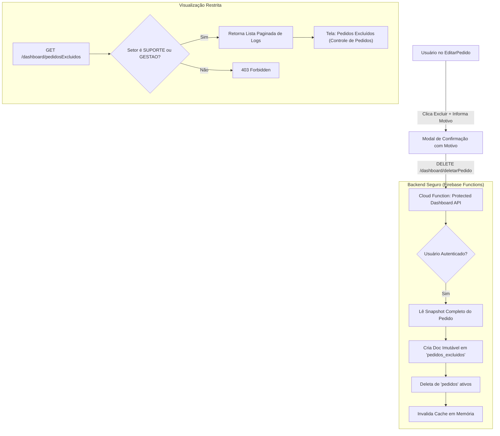

# Plano de Implementação: Log de Auditoria de Pedidos Excluídos

## 1. Visão Geral e Objetivo
Implementar um sistema de auditoria e rastreabilidade para pedidos excluídos no sistema **Controle de Pedidos**, garantindo que nenhuma informação seja perdida permanentemente e que apenas perfis autorizados (**Suporte** e **Coordenação / Gestão**) tenham visibilidade sobre quem excluiu, quando, o motivo e todos os dados originais do pedido.

---

## 2. Diagnóstico da Situação Atual
* **Comportamento atual**: A rota `DELETE /dashboard/deletarPedido` executa diretamente `await pedidoRef.delete();` na coleção `pedidos` do Firestore.
* **Problemas identificados**:
  1. Perda irreversível de dados (cliente, itens, valores, datas de entrega, histórico de status);
  2. Inexistência de logs registrando quem solicitou ou executou a exclusão;
  3. Ausência de campo de justificativa / motivo da exclusão;
  4. Impossibilidade de recuperar um pedido apagado por engano ou auditar erros operacionais.

---

## 3. Arquitetura da Solução



---

## 4. Estrutura de Dados (`pedidos_excluidos`)
Cada registro será criado com ID próprio ou o ID original do pedido em uma nova coleção Firestore `pedidos_excluidos`:

```typescript
export interface PedidoExcluidoLog {
  id: string; // ID original do pedido
  pedidoId: string;
  pedidoNumero?: string | number;
  dadosOriginais: Record<string, any>; // Snapshot completo do pedido (cliente, itens, prazos, etc.)
  excluidoPor: {
    uid: string;
    nome: string;
    email: string;
    setor: string;
  };
  excluidoEm: FirebaseFirestore.Timestamp;
  motivo: string;
  ipOrigem?: string;
  userAgent?: string;
  restaurado?: boolean;
  restauradoEm?: FirebaseFirestore.Timestamp | null;
  restauradoPor?: {
    uid: string;
    nome: string;
  } | null;
}
```

---

## 5. Etapas de Implementação

### Etapa 1: Backend (`functions/`)
1. **Modificar rota `DELETE /dashboard/deletarPedido`** em `functions/src/controle-pedidos/routes/protected/protectedDashboardRoutes.ts`:
   * Receber `pedidoID` e obrigatoriamente `motivo` (ou capturar do body);
   * Obter `user` da requisição autenticada (`uid`, `name`, `email`, `setor`);
   * Ler o snapshot completo do documento `pedidos/{pedidoID}`;
   * Gravar na coleção `pedidos_excluidos` com metadados de auditoria;
   * Excluir da coleção ativa `pedidos` e invalidar cache.
2. **Criar rota `GET /dashboard/pedidosExcluidos`**:
   * Protegida por `createSetorMiddleware(["SUPORTE", "GESTAO", "COORDENACAO"])`;
   * Paginação (`page`, `limit`), ordenação decrescente por `excluidoEm`;
   * Filtros opcionais por período (`dataInicio`, `dataFim`), responsável pela exclusão e busca por cliente/número.
3. **Criar rota `POST /dashboard/restaurarPedido/:id`** *(Recurso de segurança)*:
   * Permite que Suporte/Coordenação reverta a exclusão caso necessário, recriando o pedido na coleção ativa e marcando `restaurado: true` no log.
4. **Regras de Segurança (`firestore.rules`)**:
   * Bloquear leitura client-side direta de `pedidos_excluidos` exceto para usuários com claims/setor de suporte/gestão;
   * Bloquear criação/alteração/exclusão direta pelo client-side (somente Admin SDK via Cloud Functions).

---

### Etapa 2: Frontend (`controle-pedidos/`)
1. **Modal de Exclusão em `EditarPedido.tsx`**:
   * Adicionar campo de justificativa obrigatório:
     * Opções rápidas: *"Cancelado pelo cliente"*, *"Pedido duplicado"*, *"Erro de cadastro"*, *"Outro (digitar)"*;
   * Enviar `{ pedidoID, motivo }` para a API.
2. **Menu e Rota Restrita**:
   * Em `Navbar.tsx` / `Sidebar.tsx`:
     * Exibir botão/item **"Logs de Exclusão"** somente se `user.setor === "SUPORTE" || user.setor === "GESTAO"`;
   * Em `App.tsx`:
     * Registrar rota restrita `/pedidos-excluidos`, protegida por `ProtectedRoute` verificando setor.
3. **Nova Página `PedidosExcluidos.tsx`**:
   * Cabeçalho de auditoria com KPIs (Total de exclusões no mês, principais motivos);
   * Filtros por data, responsável e busca rápida;
   * Tabela com:
     * Nº do Pedido / ID;
     * Cliente;
     * Data/Hora da Exclusão;
     * Excluído por (Nome e Setor);
     * Motivo informado;
     * Valor do Pedido;
     * Ação: "Visualizar Detalhes do Pedido Excluído" e "Restaurar Pedido".
4. **Modal `DetalhesPedidoExcluidoModal.tsx`**:
   * Exibe o espelho do pedido exatamente como estava antes de ser apagado (itens, observações, histórico de produção).

---

## 6. Matriz de Permissões

| Perfil / Setor | Pode Excluir Pedido? | Precisa Justificar? | Pode Ver Logs de Exclusão? | Pode Restaurar? |
| :--- | :---: | :---: | :---: | :---: |
| **Suporte** | Sim | Sim | Sim | Sim |
| **Coordenação / Gestão** | Sim | Sim | Sim | Sim |
| **Atendimento / Balcão** | Sim | Sim | Não | Não |
| **Produção / Arte / Galpão** | Não | — | Não | Não |

---

## 7. Critérios de Aceite e Testes
1. **Teste de Exclusão**: Ao excluir um pedido, validar se o registro em `pedidos_excluidos` foi gerado com todos os dados originais, usuário autenticado e motivo.
2. **Teste de Bloqueio por Setor**:
   * Usuários com setor `BALCAO`, `PRODUCAO_LOJA`, `ARTE` recebem HTTP 403 ao tentar chamar `GET /dashboard/pedidosExcluidos`;
   * Usuários com setor `SUPORTE` e `GESTAO` acessam com sucesso (HTTP 200).
3. **Teste de Imutabilidade**: Nenhum usuário pode apagar registros da coleção `pedidos_excluidos`.
4. **Teste de Restauração**: Ao restaurar um pedido, ele volta a aparecer no Dashboard principal mantendo os dados originais.

