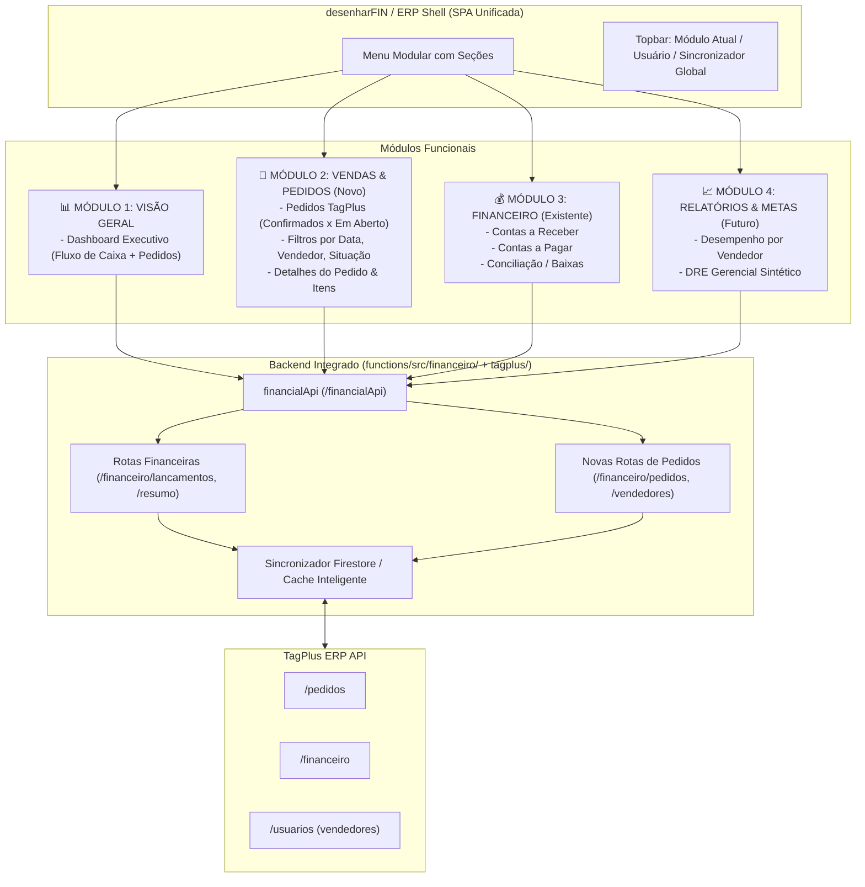

# Plano Estratégico: Expansão do Sistema Financeiro em Módulos (ERP Financeiro & Operacional)

> **Status:** Proposta de Arquitetura Modular  
> **Data:** 12/11/2026  
> **Sistema Base:** `financeiro/` (`https://financeiro-desenhar.web.app`)  
> **Backend Base:** `functions/src/financeiro/` (`financialApi`)  
> **Integração Externa:** API TagPlus ERP (`https://developers.tagplus.com.br/doc`)

---

## 1. Visão Geral da Visão Modular

A ideia de transformar o **Financeiro** em uma plataforma corporativa modular é uma excelente decisão de arquitetura. Em vez de espalhar múltiplos sistemas isolados pela empresa (com múltiplos links e autenticações separadas), centralizamos a gestão comercial e financeira sob uma mesma suíte unificada (**desenharERP / desenharFIN**).

### Principais Vantagens dessa Abordagem:
1. **Ponto Único de Acesso (SSO):** O usuário faz login uma única vez com a conta Google corporativa (`@desenhardigital.com.br`) e transita entre os módulos autorizados.
2. **Visão 360° da Venda ao Faturamento:** O operador pode ver o pedido de venda gerado no TagPlus e seu reflexo direto em contas a receber, faturamento e fluxo de caixa.
3. **Economia de Infraestrutura & Manutenção:** Menos projetos no Firebase Hosting, compartilhamento do mesmo design system leve (CSS nativo rápido, sem inchaço de dependências) e reaproveitamento do mesmo backend `financialApi`.
4. **Governança de Permissões:** Controle por perfil/setor (ex.: operador comercial enxerga apenas *Pedidos*, financeiro enxerga *Contas a Pagar/Receber*, e gestão tem acesso geral).

---

## 2. Arquitetura Modular Proposta

Transformamos a navegação lateral (`FinanceiroShell.tsx`) de uma lista linear de páginas para **Grupos de Módulos**:



---

## 3. Especificação do Novo Módulo: "Vendas & Pedidos TagPlus"

### 3.1. Localização no Sistema
- Rota interna / Tab: `pedidos` (ex.: Menu lateral sob seção **COMERCIAL / VENDAS**).

### 3.2. Funcionalidades da Página de Pedidos (`PedidosPage.tsx`)
1. **Barra Superior de Filtros Rápidos:**
   - **Status de Confirmação:** Segmented Control / Tabs:
     - `Todos`
     - `Confirmados` (faturados/aprovados)
     - `Não Confirmados` (em aberto / orçamento / aguardando)
     - `Cancelados`
   - **Período:** Seletores de Data Início / Fim + atalhos rápidos (*Hoje*, *Ontem*, *Últimos 7 dias*, *Mês Atual*).
   - **Vendedor:** Dropdown pesquisável com a lista dos vendedores da TagPlus.
   - **Busca por Termo:** Busca por número do pedido, nome do cliente ou CPF/CNPJ (com debounce de 350ms).
2. **Cards Resumo (KPIs de Vendas):**
   - Total de Pedidos no Período.
   - Valor Total Faturado/Confirmado (R$).
   - Valor Total em Aberto / Pendente (R$).
   - Ticket Médio por Pedido.
3. **Tabela de Pedidos:**
   - Colunas: *Nº Pedido*, *Emissão*, *Cliente*, *Vendedor*, *Valor Total*, *Status*, *Ações*.
   - Badge visual claro:
     - Verde: Confirmado.
     - Amarelo/Laranja: Em Aberto / Pendente.
     - Vermelho: Cancelado.
   - Ação: Botão para abrir gaveta/modal lateral com detalhes.
4. **Modal / Gaveta Lateral de Detalhes:**
   - Lista completa dos produtos/serviços inclusos (Qtd, Unitário, Desconto, Subtotal).
   - Condição de pagamento e parcelamento.
   - Observações gerais e dados de entrega.
   - Link de relacionamento direto: *"Ver lançamento financeiro correspondente"* (quando faturado).

---

## 4. Estrutura de Arquivos no Frontend e Backend

### 4.1. Frontend (`financeiro/src/`)
```
financeiro/src/
├── components/
│   ├── layout/
│   │   ├── FinanceiroShell.tsx        # Menu expandido com seções (Financeiro / Comercial / Relatórios)
│   ├── pedidos/                      # [NOVO] Componentes do módulo de pedidos
│   │   ├── PedidosFiltros.tsx        # Seletor de status, data, vendedor e busca
│   │   ├── PedidosKpis.tsx           # Cards de totais e ticket médio
│   │   ├── PedidosTable.tsx          # Tabela com badges e paginação
│   │   └── PedidoDetalhesModal.tsx   # Modal com itens e condições de pagamento
├── pages/
│   ├── DashboardPage.tsx             # Dashboard geral (incluirá mini-resumo de pedidos)
│   ├── ContasReceberPage.tsx
│   ├── ContasPagarPage.tsx
│   └── PedidosPage.tsx               # [NOVO] Página principal do módulo de pedidos
├── hooks/
│   ├── usePedidos.ts                 # [NOVO] Hook de busca, cache e paginação de pedidos
│   ├── useVendedores.ts              # [NOVO] Hook para carregar lista de vendedores
│   ├── useLancamentos.ts
│   └── useFinanceiroSession.ts
└── contracts.ts                      # Interfaces TypeScript expandidas (TagPlusPedido, etc.)
```

### 4.2. Backend (`functions/src/financeiro/`)
```
functions/src/financeiro/
├── routes/
│   ├── lancamentos.ts                # Contas a pagar e receber (já existente)
│   ├── pedidos.ts                    # [NOVO] GET /pedidos, GET /pedidos/:id, GET /vendedores
│   ├── auxiliares.ts
│   └── sync.ts
├── FinanceiroClient.ts               # Adicionar métodos buscarPedidos e buscarUsuarios
└── financeiroSync.ts                 # Adicionar sincronização incremental de pedidos no Firestore
```

---

## 5. Estratégia de Transição para o Sistema Modular

Para expandir o sistema com segurança e sem impacto nas operações financeiras já ativas:

| Etapa | Ação | Detalhe |
|-------|------|---------|
| **Etapa 1** | **Backend TagPlus Pedidos** | Adicionar os métodos `buscarPedidos()` e `buscarVendedores()` no client TagPlus e expor as rotas autenticadas sob `/financialApi/pedidos`. Incluir testes de unidade automatizados no Jest. |
| **Etapa 2** | **Design Modular da Shell** | Agrupar a navegação da `FinanceiroShell` em categorias: <br>• **Visão Geral:** Dashboard<br>• **Comercial:** Pedidos TagPlus<br>• **Financeiro:** Contas a Receber, Contas a Pagar |
| **Etapa 3** | **Construção do Módulo de Pedidos** | Criar `PedidosPage.tsx`, tabela, KPIs, filtros (datas, vendedor, confirmados x abertos) e modal de itens. |
| **Etapa 4** | **Testes Locais (Dev)** | Testar com a base real do TagPlus em modo de desenvolvimento local (`npm run dev`), garantindo estabilidade e performance. |
| **Etapa 5** | **Deploy Controlado** | Publicação das `functions` e do frontend `financeiro` no Firebase Hosting com verificação em produção. |

---

## 6. Próximos Passos Imediatos

Se concordar com este plano de arquitetura modular integrada:
1. Iniciamos pela **Etapa 1 (Backend)**: criação das rotas de pedidos e vendedores dentro da API de `financeiro` com os testes Jest garantidos.
2. Em seguida, implementamos o **Frontend (Etapas 2 e 3)** no próprio app `financeiro`.

Podemos começar a implementação do backend da Etapa 1?

