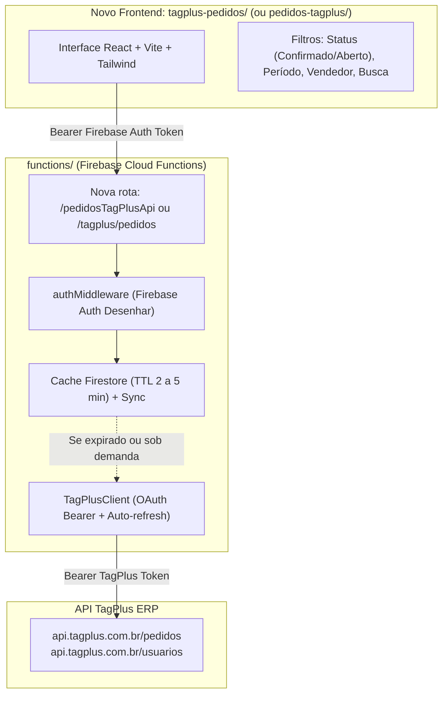
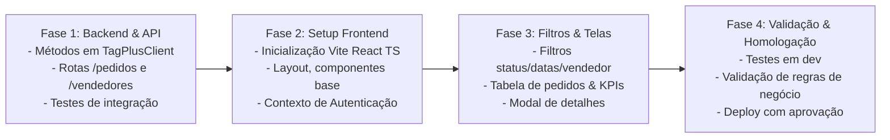

# Plano de Implementação: Sistema de Acompanhamento de Pedidos TagPlus

> **Status:** Proposta de Arquitetura e Plano de Criação  
> **Data:** 12/11/2026  
> **Projeto:** desenhar (`gestaopedidos-desenhar`)  
> **Referência Oficial:** [API TagPlus Doc](https://developers.tagplus.com.br/doc)

---

## 1. Visão Geral e Viabilidade

Sim, **é totalmente viável e altamente recomendado** estruturar esse novo sistema aproveitando a infraestrutura já consolidada no ecossistema da Desenhar Digital.

### Principais Objetivos do Novo Sistema:
1. **Listagem e Acompanhamento em Tempo Real:** Visualização tabular e em cards dos pedidos de venda criados no TagPlus.
2. **Filtro de Status / Confirmação:** Filtrar rapidamente pedidos **confirmados**, **em aberto (não confirmados)** e **cancelados**.
3. **Filtro por Período (Datas):** Filtrar por data de criação, emissão ou faturamento (início e fim) com atalhos rápidos (Hoje, Ontem, Esta Semana, Este Mês, Personalizado).
4. **Filtro por Vendedores:** Seleção de vendedor responsável (alimentado pela lista de usuários/vendedores cadastrados no TagPlus).
5. **Busca e Detalhamento:** Pesquisa rápida por número do pedido, código, cliente (nome/CNPJ/CPF) e visualização modal com itens do pedido, totais e condições de pagamento.
6. **Desempenho e Segurança:** Integração backend via Cloud Functions com cache inteligente no Firestore (evitando gargalos de limites de requisições por IP da API do TagPlus) e autenticação de usuários da Desenhar (`@desenhardigital.com.br`).

---

## 2. Diagnóstico da API TagPlus (Documentação Oficial)

Conforme a documentação da TagPlus (`https://developers.tagplus.com.br/doc`):

| Recurso / Endpoint | Escopo Necessário | Finalidade |
|--------------------|-------------------|------------|
| `GET /pedidos` | `read:pedidos` | Listagem de pedidos de venda com suporte a paginação (`page`, `per_page`), campos adicionais e filtros |
| `GET /pedidos/:id` | `read:pedidos` | Consulta dos detalhes completos do pedido (itens, formas de pagamento, observações) |
| `GET /usuarios` | `read:usuarios` | Listagem dos vendedores/usuários do sistema para preenchimento dos filtros |
| `GET /clientes` | `read:clientes` | Consulta e enriquecimento de dados de clientes (já implementado no backend) |

### Requisitos de Escopo OAuth
O backend atual já possui o fluxo OAuth e auto-refresh operando em `functions/src/tagplus/`. O escopo padrão atual já contempla `read:pedidos`. Para o filtro completo de vendedores, basta garantir a presença do escopo `read:usuarios` no cadastro do aplicativo TagPlus e na URL de autorização.

---

## 3. Arquitetura da Solução

Seguindo o padrão de microsserviços frontend já consolidado com sucesso no projeto (como `financeiro/` e `crm/`):

### Por que manter o padrão com Backend Proxy + Cache?
1. **Segurança de Credenciais:** As chaves OAuth `client_secret` e tokens do TagPlus nunca são expostos no navegador.
2. **Prevenção de Rate Limit:** O ERP TagPlus impõe limites de requisições por minuto. Consultas com múltiplos filtros compartilhadas entre operadores devem utilizar cache em memória/Firestore.
3. **Padronização:** Uniformiza a tipagem de dados, tratando status, formatações de moeda e datas no fuso horário local.

---

## 4. Estrutura do Novo Sistema

### 4.1. Frontend (`tagplus-pedidos/`)
- **Stack:** React 19 + TypeScript + Vite + Tailwind CSS + Lucide Icons.
- **Telas / Módulos:**
  1. **Barra Superior de Filtros:**
     - **Status de Confirmação:** [Todos] | [Confirmados] | [Não Confirmados / Em Aberto] | [Cancelados].
     - **Seleção de Período:** Datepicker (De / Até) com botões rápidos: *Hoje*, *Últimos 7 dias*, *Mês Atual*.
     - **Seleção de Vendedor:** Dropdown com busca por nome de vendedor.
     - **Busca Textual:** Campo de busca rápida com *debounce* (busca por número de pedido ou cliente).
  2. **Cards de Métricas (KPIs Resumo):**
     - Total de Pedidos no Período.
     - Valor Total Faturado/Confirmado.
     - Valor Total em Aberto (A Confirmar).
     - Ticket Médio por Vendedor.
  3. **Tabela / Grid de Pedidos:**
     - Número do Pedido / Código.
     - Data e Hora de Emissão.
     - Nome do Cliente e Documento (CPF/CNPJ).
     - Vendedor Responsável.
     - Valor Total (R$).
     - Badge de Status (Verde para Confirmado, Amarelo para Pendente/Aberto, Vermelho para Cancelado).
     - Botão de Ação: Ver detalhes.
  4. **Gaveta / Modal de Detalhes do Pedido:**
     - Lista de Itens/Produtos com quantidade, valor unitário e subtotal.
     - Forma de pagamento e prazos.
     - Observações internas e dados de entrega/faturamento.
  5. **Controle de Paginação:**
     - Paginação limpa com seletor de itens por página (20, 50, 100).
     - Botão "🔄 Atualizar Dados" para forçar sincronização fresca.

### 4.2. Backend (`functions/src/tagplus/`)
- **Novas Rotas na API:**
  - `GET /pedidos`: Retorna a lista paginada e filtrada de pedidos (com suporte aos filtros `status`, `data_inicio`, `data_fim`, `vendedor_id`, `q`, `page`, `per_page`).
  - `GET /pedidos/:id`: Detalhes completos do pedido individual.
  - `GET /vendedores`: Lista consolidada de vendedores/usuários da TagPlus para alimentar o select do frontend.
  - `POST /pedidos/sync`: Limpa o cache e força uma leitura imediata da TagPlus.

### 4.3. Hosting e Domínio
- Novo arquivo de configuração Firebase: `firebase.tagplus-pedidos.json`.
- Site de Hosting no Firebase: `pedidos-tagplus` ou `tagplus-pedidos` (ex: `https://tagplus-pedidos-desenhar.web.app`).

---

## 5. Fases de Execução

| Fase | Escopo Detalhado | Entregáveis |
|------|------------------|-------------|
| **Fase 1: Backend** | - Implementar `buscarPedidos()` e `buscarVendedores()` na classe `TagPlusClient.ts`. - Criar rotas no Express (`funcTagPlus.ts` ou rota dedicada). - Implementar sanitização, tipagens e cache Firestore. - Criar testes unitários e de integração no Jest. | Endpoints prontos e testados com Jest (`100% pass`). |
| **Fase 2: Frontend Base** | - Inicializar workspace `tagplus-pedidos/` com Vite, Tailwind e padrões de design da Desenhar. - Integrar autenticação Firebase Auth existente e serviço de API (`FetchWithAuth`). | Aplicação executando em modo dev (`npm run dev`) com login. |
| **Fase 3: Interface & Filtros** | - Construir painel de filtros (Confirmados x Não Confirmados, Datas, Vendedores). - Construir KPIs e tabela responsiva com paginação. - Criar modal com itens e detalhes do pedido. | Funcionalidades de listagem, busca e filtragem completas. |
| **Fase 4: Validação & Deploy** | - Testes com dados reais em ambiente dev. - Ajuste de permissões de setor (ex: VENDAS, PRODUCAO, GESTAO). - Criação do script de deploy e configuração no Firebase Hosting. | Deploy em produção após aprovação. |

---

## 6. Decisões Recomendadas para Alinhamento

1. **Nome do Sistema / Subpasta:** Sugerimos `tagplus-pedidos/` ou `acompanhamento-pedidos/`.
2. **Permissão de Acesso:** Quais setores devem ter acesso a esse painel? (Ex: `GESTAO`, `SUPORTE`, `ATENDIMENTO`, `PRODUCAO` ou aberto a todos autenticados com e-mail `@desenhardigital.com.br`?).
3. **Escopo do TagPlus:** Confirmar se o aplicativo TagPlus cadastrado já possui o escopo `read:usuarios` ativo para listar os nomes dos vendedores diretamente da API.

---
Documento gerado e disponível em `docs/plano-sistema-pedidos-tagplus.md`.

